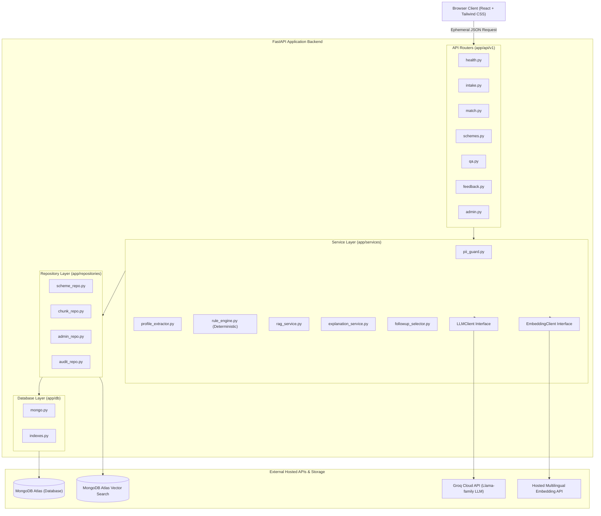
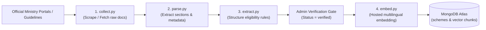
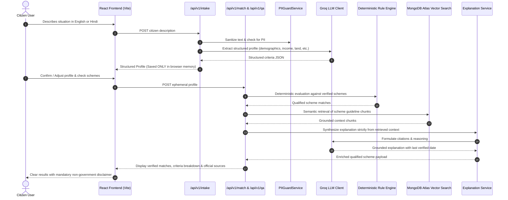

# YojanaSetu System Architecture

YojanaSetu is an AI-powered government scheme discovery and navigation platform for Indian citizens. It combines natural language understanding with a strictly deterministic eligibility evaluation engine.

---

## 1. Architectural Principles & Invariants

1. **Deterministic Eligibility:** The LLM extracts citizen criteria and generates clear human explanations. **The LLM never decides eligibility.** Qualification is decided strictly by a deterministic Python rule engine evaluating structured criteria.
2. **Verified Schemes Only:** Only schemes verified by an administrator against an official ministry source are surfaced to citizens.
3. **Citation & Verification Integrity:** Every scheme card and explanation includes the official government source URL and a "last verified" timestamp. If information is missing from the official text, the system explicitly disclaims it rather than guessing.
4. **Zero PII Persistence:** No personal identifiers (Aadhaar, PAN, phone number, email, bank details, or residential address) are requested or persisted. User profile state resides exclusively in browser memory and is transmitted ephemerally per request.
5. **Strict Layered Separation:**
   - **Routers (`app/api/v1`)** handle HTTP requests, headers, and input/output serialization. No business logic resides in routers.
   - **Services (`app/services`)** orchestrate business workflows, rules, and external interfaces. Services never import routers.
   - **Repositories (`app/repositories`)** manage data persistence and vector queries.
   - **Database (`app/db`)** provides raw database client lifecycles.
   - **Pluggable Clients:** The LLM resides behind an `LLMClient` interface and embeddings behind an `EmbeddingClient` interface, ensuring zero vendor lock-in and zero heavy local models in production.

---

## 2. Layered Architecture Diagram

---

## 3. Data Flows

### A. Offline Data & Scheme Ingestion Pipeline

### B. Online Citizen User Flow

